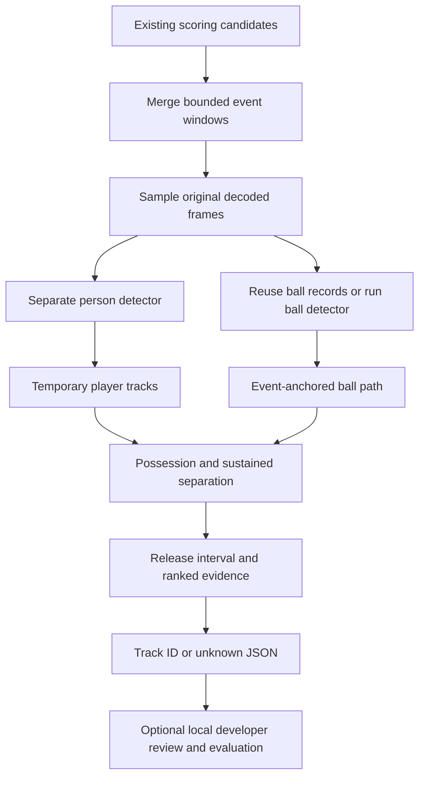

# Automatic shooter attribution: PR1

The initial baseline is documented below. The current CLI defaults to the
[v2 joint release/trajectory method](SHOOTER_ATTRIBUTION_V2.md), developed after
the first-quarter human review. Use `--algorithm baseline` to reproduce the
baseline association method on a specified observation set.

PR1 is an independent local Python analysis tool. It takes existing scoring
candidates and returns a temporary player track or `unknown`. Its development
review page writes a separate labels file. It does not assign roster IDs, modify
manual labels, write SQLite, change Flutter, change scoring decisions, or affect
highlight export. Persistent identity, product review UI and mobile deployment
belong to subsequent PRs.

## Repository investigation and integration boundary

The current pipeline is `scan_video.py` → `generate_candidates.py` →
`refine_dynamic_candidates.py`, orchestrated by
`basketball_engine/adapters/analysis.py`. `inference.load_detector` selects the
existing PyTorch/ORT backend; device priority is CUDA, DirectML, CoreML, MPS,
CPU, subject to available models/providers. The bundled model metadata identifies
`ball` and `hoop`, not people. The checkout includes `bball_model.pt`; optional
ONNX artifacts are not assumed to exist.

Detection records use `time` in source seconds and `xyxy`/`center` in the scanned
video's pixel coordinates, with crop enlargement and offsets already undone.
Coarse scans can be on a resized proxy, so those coordinates need an explicit
scale before reuse on the source. Refined overlays use source pixels. Engine
candidate rows use `event_time_ms`, deterministic `id`, and `evidence_json`.
Refined artifacts use `results[].refined[]`; coarse artifacts use `candidates[]`.
The adapter accepts all three without changing them. Explicitly supplied engine
rows are not filtered based on their manual review status.

Existing `tracking.link_ball_detections` links ball centers near a scoring anchor
but drops confidence and box size. Existing descent prediction is designed above
the rim. Neither establishes player tracking or pre-release visibility. Attribution
therefore reuses **detection records**, adding a separate confidence-preserving,
size- and motion-gated trajectory builder. Existing cache keys and scoring
algorithms are untouched. Private cache lists can be wrapped as
`{"records": [...], "video": "source.mp4"}` for explicit reuse.

CodeGraph was initialized only at the BHE repository root. Architecture, symbols,
call relationships and blast radius were inspected before implementation; the
index is refreshed as source changes. No reference repository, SDK, installed
package, framework or virtual environment was indexed with CodeGraph. Generated
indexes, videos, weights and experiments are ignored.

## Flow and module responsibilities



| Module | Responsibility |
|---|---|
| `player_detection.py` | Immutable detection records, coordinate normalization, replaceable detector protocol, existing local YOLO backend adapter |
| `player_tracking.py` | Short-session motion/IoU associations, low-confidence rescue, histories and ambiguity flags |
| `ball_possession.py` | Scale-aware proximity and confidence-preserving, event-anchored ball reconstruction |
| `shot_release.py` | Continuous possession, upper-body geometry, relative separation, later-possession veto and release uncertainty |
| `shooter_attribution.py` | Existing candidate adapters, evidence ranking, thresholds, structured unknown reasons |
| `attribution_video.py` | Window merging/expansion, bounded decode, overlap inference reuse and result artifact |
| `shooter_evaluation.py` | Human-label precision, coverage, unknown rate, score bins and timing |

Core association imports no ML package and is tested with synthetic observations.
`FrameDetector.detect(frame, timestamp)` returns `list[Detection]`. An alternative
detector only needs that contract; tracker and ranking contain no YOLO class IDs.

## Model and tracker decisions

The development baseline uses **COCO-pretrained YOLO11n** for `person`, alongside
the unchanged BHE ball model. YOLOv8n is also compatible. YOLO11n is small (about
2.6 million parameters, approximately 5.4 MiB for the official PT checkpoint) and
uses the repository's existing Ultralytics dependency. These are model properties,
not BHE throughput or accuracy measurements. See the
[official YOLO11 model documentation](https://docs.ultralytics.com/models/yolo11/).

YOLOX Nano/Tiny was considered for its small models and Apache-2.0 codebase, but
would require another inference/preprocessing adapter and explicit weight-rights
verification. See the [upstream model table](https://github.com/Megvii-BaseDetection/YOLOX).
Larger detectors and pose models are deferred until labeled evidence justifies
their runtime cost.

Ultralytics models are offered under AGPL-3.0 and enterprise terms. BHE's MIT
source license does not relicense them. The implementation neither bundles nor
automatically downloads person weights. Obtain an appropriate local checkpoint
from the publisher under the applicable terms, preserve its source/version/hash,
and pass its path explicitly. See [model licensing](https://docs.ultralytics.com/models/yolo11/)
and BHE's [model and data policy](MODEL_AND_DATA_LICENSES.md). The added `dill`
dependency (BSD-3-Clause) reads serialization metadata in the existing BHE PT
checkpoint; no training dependency or cloud service is added.

ByteTrack's two-stage high/low-confidence association and BoT-SORT's motion and
optional camera compensation were evaluated. The selected baseline is an
independently implemented two-stage geometry tracker: constant-velocity box
prediction, gated IoU/normalized center distance, deterministic greedy assignment,
short timestamp-based loss buffer, and explicit near-tie ambiguity. It is **not**
a full ByteTrack or BoT-SORT implementation. It avoids Supervision, LAP/compiled
assignment dependencies, Re-ID models and backend-specific tracker APIs. This
trades crowded-scene identity robustness for a small, inspectable baseline.
Camera movement and severe crossings should lower coverage through abstention.
See [the upstream tracking comparison](https://docs.ultralytics.com/modes/track/)
and [BoT-SORT](https://github.com/NirAharon/BoT-SORT).

## Installation and commands

Use BHE's supported Python environment (Python 3.11 is documented by the project;
this PR was also tested on 3.12). Install the existing runtime plus the checkpoint
metadata dependency before disconnecting from the network:

```bash
python -m pip install -r requirements-shooter.txt
python -m pip install -r requirements-dev.txt

python scripts/attribute_shooters.py \
  --video game.mp4 \
  --candidates candidates.json \
  --player-model /path/to/local/yolo11n.pt \
  --ball-model models/bball_model.pt \
  --device auto \
  --output .cache/shooter/predictions.json
```

`--device` uses BHE's existing backend selection and CPU fallback. DirectML and
CoreML require the corresponding exported weights and providers, including
correct class-name metadata for the person model. Neither is a PR1 mandatory
dependency. Missing files fail before model loading; attribution disables
Ultralytics' implicit dependency autoinstall. GPU acceleration remains optional.

Optional ball reuse (an absent/unaligned cached observation triggers inference):

```bash
python scripts/attribute_shooters.py \
  --video game.mp4 --candidates candidates.json \
  --player-model /path/to/local/yolo11n.pt \
  --ball-records source-detections.json \
  --output .cache/shooter/predictions.json
```

For a half-resolution proxy log add `--records-scale 2`. Record times from a
clipped proxy need `--records-time-offset` **only if** its scanner did not already
write the source offset. Scale is source pixels per cached pixel, applied to all
four box coordinates. Crop offsets must already be resolved, as in native BHE
scan logs. No implicit proxy guessing is performed. `--cached-ball-only` disables
fallback inference and requires `--ball-records`; incomplete input yields unknown.

## Configuration and evidence

| CLI/config setting | Default | Meaning |
|---|---:|---|
| `--window-before` | 4 s | Initial pre-event window |
| `--max-window-before` | 8 s | Retry earlier when the release is not observed |
| `--window-after` | 0.15 s | Post-event decode margin; prefer refined timestamps for coarse candidates |
| `--sample-fps` | 12 | Maximum inference sampling rate, capped at video FPS |
| `--player-conf` | 0.15 | Detector retention threshold; new tracks require 0.45 |
| `--ball-conf` | 0.10 | Minimum ball detection score |
| `--player-imgsz`, `--ball-imgsz` | 640 | Model input size, multiple of 32 |
| `--ball-tiles` | 1 | 1=full frame; 2/3 adds overlapping grids plus full frame |
| `--ball-max-gap` | 0.35 s | Maximum occlusion bridge; no interpolation |
| `--min-score` | 0.78 | Minimum heuristic ranking score |
| `--min-margin` | 0.12 | Minimum winner/runner-up score difference |
| `--min-track-reliability` | 0.55 | Minimum local observation coverage × mean person score |
| `player_max_gap` (Python config) | 0.5 s | Track expiry after an observation gap |

Person detection operates on the full original frame. Ball tiles are optional
because full-frame downsampling can lose a small ball near the shooter. No image
frames are retained beyond inference; compact observations are memoized within
the call. Overlapping candidates share decode/inference windows. Expansion may
decode an overlap again but skips previously inferred frame indices. There is no
full-game person tracking, disk inference-cache framework, or runtime network API.

Ball reconstruction starts from an actual observation near the scoring time,
using the candidate's rim where available. It links backwards with elapsed-time
speed, constant-velocity residual and relative ball-size gates. Comparable
branches mark the result ambiguous. Temporal gaps are preserved, and long gaps
terminate the chain. Existing crop detections alone often cannot see the release.
Branch costs use ball diameters and detection scores, keeping ambiguity gates
independent of image resolution. Overlapping tile detections are deduplicated.

Possession uses distance **outside the player box divided by player height**,
allowing a held ball outside the box. The default estimator requires at least
two contiguous held-ball samples over at least 60 ms in a 450 ms lookback,
upper-body release geometry, at least three following observations, sustained
separation and displacement. A subsequent multi-sample possession vetoes an
earlier pass/rebound hypothesis, letting the final releaser be assessed separately.
`ShotReleaseEstimator` exposes those evidence thresholds as constructor arguments.
It never requires upward motion alone. Flight is linked to the supplied scoring
event, whose made/missed accuracy remains the responsibility of the upstream
pipeline and human review.

The ranking score is `0.25 possession consistency + 0.20 proximity +
0.20 separation + 0.20 local track reliability + 0.15 mean ball detection score`.
Features are bounded in [0,1]. Scores rank evidence; **they are not calibrated
probabilities**. The precision-first thresholds are initial heuristics, not a
95% accuracy claim. Ambiguous player associations, similar shooter hypotheses,
weak track support, missing release observations and incomplete/ambiguous ball
paths return `unknown` with `shooter: null`.

## JSON contract (schema version 1)

The artifact contains `schema_version`, video fingerprint, frame dimensions,
configuration, `results`, `sessions`, and performance metadata. Boxes are xyxy
pixels in the source's decoded display frame (after decoder orientation), with
origin at top left. Observation timestamps are source seconds. Fields ending
`_ms` are source milliseconds. Sampling retains OpenCV PTS when available and
uses frame-index/FPS time only when the backend does not expose usable PTS.

Example result (illustrative values):

```json
{
  "candidate_id": "candidate_example",
  "event_time_ms": 123456,
  "tracking_scope": "session_example",
  "status": "attributed",
  "method": "possession_trajectory_v1",
  "score_kind": "heuristic_not_calibrated",
  "reason": "supported_release",
  "shooter": {
    "track_id": 7,
    "score": 0.87,
    "score_kind": "heuristic",
    "release_time_ms": 121850,
    "release_interval_ms": [121800, 121900],
    "release_position": [650, 420],
    "evidence": {}
  },
  "rankings": [],
  "analysis_window_ms": [119456, 123606],
  "ball_trajectory": {
    "observations": [], "missing_times": [], "ambiguous": false, "reason": null
  },
  "window_expanded": false,
  "processing_seconds": 1.0
}
```

`release_time_ms` is the midpoint between the last held observation and first
separated observation; the interval is the primary timing uncertainty. The
position is the last held ball center, not an invented interpolated hand point.
Unknown results can retain rankings for debugging but never promote a hypothesis
to `shooter`. Each session exposes track histories and ambiguous association
times. Identify a track by **(tracking_scope, track_id)**. IDs can change on rerun;
the scope includes video/config/window and track histories, so old labels cannot
silently bind to a different set of tracks. There is no cross-session identity.

## Temporary human review and evaluation

The development helper is separate from Flutter and its review database:

```bash
python scripts/review_shooters.py \
  --predictions .cache/shooter/predictions.json \
  --video game.mp4 \
  --labels .cache/shooter/labels.json --port 8765
```

Open the printed loopback URL. If the browser cannot decode the source, supply a
same-timeline H.264 proxy (no time trim). The UI scales source-coordinate boxes
to the player, pauses at release, allows frame stepping/slow replay, and records
the actual shooter, an unresolvable shooter, or a non-scoring event. Confirmations
are saved atomically to the chosen local labels file; they do not edit predictions.
The server only serves fixed review/video/artifact endpoints and listens on
127.0.0.1. Stop it with Ctrl+C. Do not publish private footage or labels.

Label example:

```json
[
  {"candidate_id": "candidate_example", "tracking_scope": "session_example",
   "is_scoring": true, "shooter_track_id": 7, "note": "Visible release"}
]
```

`shooter_track_id: null` means human ground truth could not be resolved, not that
an algorithmic unknown was proven correct. Non-scoring candidates are excluded
from shooter metrics. Unreviewed and stale-scope labels never count as successes.

```bash
python scripts/evaluate_shooters.py \
  --predictions .cache/shooter/predictions.json \
  --labels .cache/shooter/labels.json \
  --output .cache/shooter/evaluation.json
```

Precision = correct assigned predictions / assigned predictions with resolvable
human truth. Coverage = assigned / reviewed scoring events. Unknown rate =
unknown / reviewed scoring events. The report explicitly counts predictions
without resolvable truth and unmatched labels. Score bins support future
calibration investigation; no calibration is asserted. With no labels, precision
is null. Review all candidates, including unknowns, rather than only favorable
examples. For broader evaluation, add separately labeled uncontested/contested
jump shots, layups, catch-and-shoots, putbacks, passes, crowded releases,
occlusions and interruptions. Keep tuning and held-out footage separate.

The optional label field `review_kind` distinguishes scoped shooter labels,
unresolvable shooters, non-scoring events and `event_only` annotations. After a
rerun changes tracking scopes, an event-only annotation can preserve a human
made/missed judgment only after verifying the same video fingerprint, candidate
ID and event timestamp. It carries no shooter ID and never contributes a correct
prediction to precision. Original review files should remain intact.

Performance reports include total pipeline wall time, detector time, unique
sampled frames, reused ball frames, session count, and completion RSS when psutil
is present. Candidate timing is session wall time divided by candidate count;
it is amortized work, not independently measured latency. CLI model-loading time
is outside pipeline timing. Completion RSS is not peak memory or GPU allocation.
CPU/MPS/CUDA throughput and peak RAM must be measured on their actual hardware.

## Validation and limitations

```bash
python -m pytest -q tests/test_shooter_attribution.py \
  tests/test_shooter_video.py tests/test_shooter_evaluation.py
python -m pytest -q
python scripts/check_open_source.py
```

Generated tiny videos test the real decoder and full pipeline with injected
deterministic detections. Synthetic regression tests cover geometry, scale,
timestamps, brief occlusion, expiry, low-confidence rescue, six players,
ambiguous tracks/balls, passes before shots, close finishes, unknowns, thresholds,
overlap reuse, output adapters, metrics and feedback persistence. They establish
logic behavior, not real-world detection accuracy. Actual private two-player
footage is a useful initial experiment; it does not validate 2v2/3v3/full-court
tracking. Experiment artifacts remain in ignored local storage.

Known limitations: small/occluded balls can end a trajectory before release;
greedy geometry tracking can switch IDs in crossings; camera motion is not
compensated; upper-body box geometry is only a proxy for hands; very quick
catch-and-shoots/putbacks may lack two possession samples; no robust camera-cut
detector exists; VFR/backend timestamp behavior needs wider platform validation.
These cases should generally reduce coverage, but precision still requires human
measurement. There is no guarantee that every bad association is flagged.

Scoring generation, trajectory decisions, verdicts and candidate schemas are
unchanged in Python and Rust. Accordingly PR1 does not modify the cross-platform
scoring contract or claim new mobile parity. Windows, Intel macOS, DirectML,
CoreML and CUDA attribution need their own inference acceptance testing.

## Reference review and future boundaries

Availability/licensing was checked on 2026-10-27. No reference code was copied:

| Reference | Useful idea | Declared repository license |
|---|---|---|
| [Basketball Event Tracking](https://github.com/jtfarrington/basketball_event_tracking) | Separate ball/player trackers, containment and continuous possession, recent possessor | None declared; no code reuse |
| [Basketball Vision Analytics](https://github.com/vinod-polinati/basketball-vision-analytics) | Proximity/IoU and recent possession as an explainable baseline | None declared; no code reuse |
| [BasketEvent](https://github.com/zhangyu2003/BasketEvent) | Separate tracking and player-level event recognition | None declared; no dependency adoption |
| [Basketball Game Tracker](https://github.com/hasan-bakr/Basketball-Game-Tracker) | Future identity work is a separate concern | MIT code; no OCR/Re-ID adoption |

Fixed pixel possession gates, upward-only triggers and unbounded ball
interpolation were not adopted. SAM3, vision-language models and TimeSformer are
outside scope. PR2 can consume `candidate_id`, `status`, `shooter`, `rankings` and
the scoped track histories in a separate suggestion workflow. PR3 can attach a
separate persistent identity mapping to scoped tracks without redefining their
temporary meaning. Neither is implemented here.
