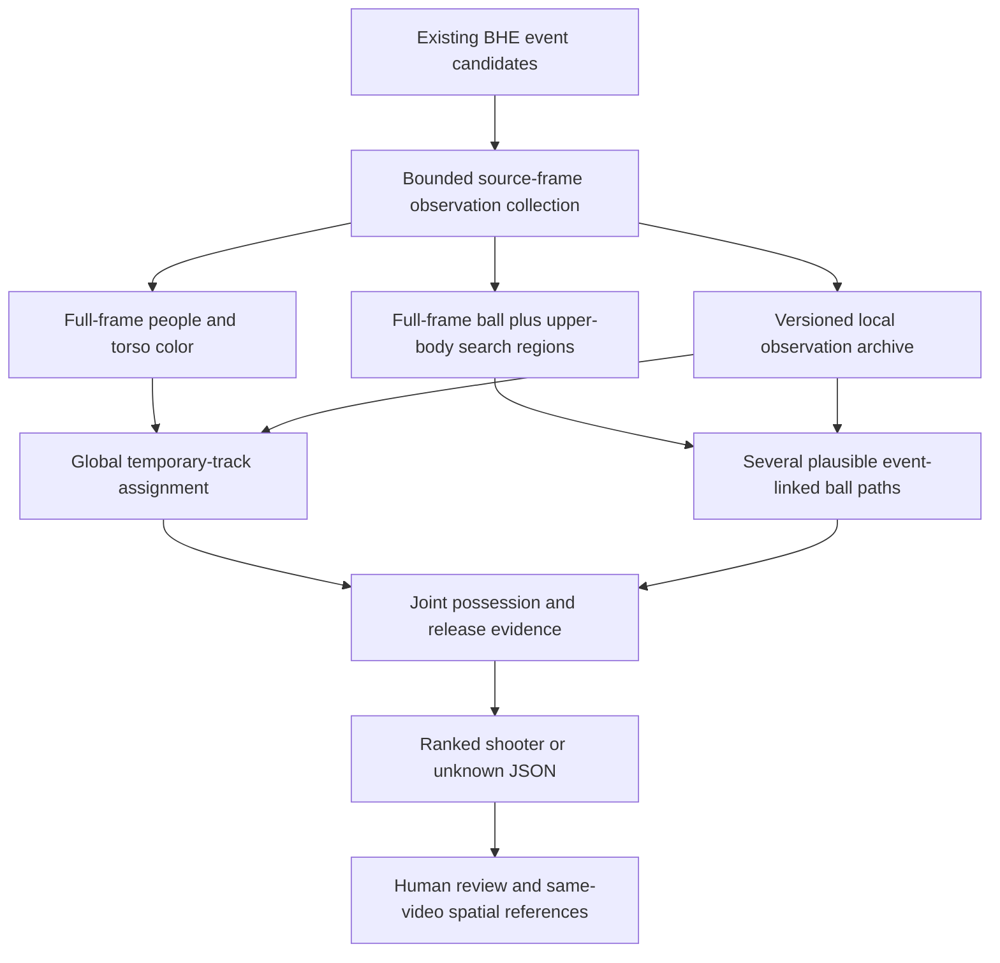

# Shooter attribution v2: joint release and trajectory evidence

An opt-in [v3 contextual method](SHOOTER_ATTRIBUTION_V3.md) adds duplicate guards,
competitive possession and explicitly validated top-of-frame gaps. The `joint`
algorithm documented here remains available unchanged.

This revision follows the first-quarter human review of the initial PR1 baseline.
The baseline assigned three of 18 confirmed baskets; an overlap also exposed an
identity switch. V2 changes the independent attribution method while keeping the
existing BHE scoring pipeline, candidate schema, database and product UI intact.

The development plan is implemented in four parts: reusable observations,
session-local appearance-assisted global tracking, multiple ball-path hypotheses,
and evaluation against human spatial references plus a separate video segment.
The original baseline source and private experiment files remain recoverable in
the developer's ignored experiment storage. The CLI also retains
`--algorithm baseline` for controlled comparisons on the same observations.

## Why the method changed

The original implementation chose one ball detection at each step and rejected
the entire event when any choice was ambiguous. Low-confidence hand-like objects
and uncertainty before possession could therefore veto an otherwise visible
release. Its nearest-frame event anchor could also fail even when a valid ball
was visible near the hoop in an adjacent frame. Greedy player assignment made
local choices that could conflict when players crossed.

V2 delays these decisions until release evidence can be evaluated. It does not
obtain higher coverage merely by lowering the attribution score threshold.

## Processing flow



## Detection and temporary player tracking

The person model and existing BHE ball weights are unchanged. A coarse 64-bin HSV
histogram is measured inside the torso box, excluding most of the head, shorts
and surrounding background. Value bins preserve useful black/white clothing
information when hue is uninformative. This is an optional local motion-association
signal, not a trained Re-ID embedding, facial recognition, jersey recognition,
roster enrollment or persistent identity. The profile is discarded with the
tracking session. It is not updated during a crowded or ambiguous association.

For high-confidence detections, followed by low-confidence rescue, a cost matrix
combines predicted box motion/IoU and optional Hellinger distance between color
histograms. A pure-Python rectangular minimum-cost assignment solver replaces
greedy edge selection. Tests compare its optimum with brute force on small
rectangular matrices, including negative costs and deterministic ties. No SciPy,
LAP, Supervision or new compiled dependency is required.

Ambiguity is measured by the total cost of an alternative assignment, rather than
only one local edge. A short timestamp-based loss buffer permits brief occlusion;
strong local color agreement can recover a track outside a strict IoU gate.
Near-tied global solutions still expose ambiguity to the attribution stage.
Color agreement alone never overrides the motion and box-scale bounds.

The combination of motion and appearance follows the general tracking ideas
described by [BoT-SORT](https://arxiv.org/abs/2206.14651), while high/low-confidence
association follows the motivation of [ByteTrack](https://arxiv.org/abs/2110.06864).
This is an independent implementation, not either reference tracker. The
[linear assignment definition](https://docs.scipy.org/doc/scipy/reference/generated/scipy.optimize.linear_sum_assignment.html)
was consulted as a mathematical reference; SciPy is not a runtime dependency.
External libraries and reference repositories were not indexed with CodeGraph.

## Ball acquisition and path hypotheses

`PlayerGuidedBallDetector` runs the ball detector on the full frame for flight
coverage and on bounded upper-body regions for held-ball/release visibility.
Regions are derived from observed player boxes and transformed back to source
pixels. They are not limited to BHE's hoop ROI. The number of guided regions is
bounded; the implementation does not assume exactly two players.

`joint_attribution.ball_path_hypotheses` searches all geometrically valid
near-event anchors instead of committing to the closest sampled frame. Backward
beam search keeps at most 12 states and exports at most six distinct paths.
Source-time gaps, speed, ball-size changes and prediction residuals gate links.
Detection scores and motion consistency contribute to path cost. A suspicious
observation may be skipped; it is never replaced by an invented ball position.
Long gaps terminate a path.

Release estimation combines multi-frame possession, upper-body geometry,
relative separation, displacement, player-track reliability and event-linked
path quality. V2 can tolerate one noisy possession sample, while retaining
minimum observation counts and temporal bounds. A later catch requires a
multi-frame, relatively slow ball/player association; a rapidly flying ball
passing through someone's projected body box is not automatically a catch.

Candidate player tracks are compared across plausible paths. Multiple credible
shooters, inconsistent release intervals, ambiguous player assignment, weak
tracks and missing release evidence still produce `unknown`. The path is selected
using the combined release evidence; uncertainty before possession no longer
automatically vetoes a supported later release.

The v2 ranking score is `0.9 × release evidence score + 0.1 × exp(-mean path cost)`.
The release evidence retains the baseline possession/proximity/separation/track/
detector-score components. Scores are heuristic rankings, not calibrated
probabilities. `--min-score 0.78`, `--min-margin 0.12` and minimum track reliability
0.55 remain unchanged from the baseline quality gates.

## CLI and observation replay

The v2 CLI defaults to joint attribution, player-guided ball search, 15 samples
per second, a four-second initial lookback, eight-second expansion limit,
0.5-second post-event margin and 0.8-second player-loss buffer. Python callers
can still supply an explicit `AnalysisConfig` for other sampling/window defaults.

```bash
python scripts/attribute_shooters.py \
  --video game.mp4 --candidates refined.json \
  --player-model /path/to/local/yolo11n.pt \
  --ball-model models/bball_model.pt \
  --algorithm joint --ball-search players --device auto \
  --output .cache/shooter/predictions-v2.json
```

To record reusable evidence, add `--observations-output`:

```bash
python scripts/attribute_shooters.py \
  --video game.mp4 --candidates refined.json \
  --player-model /path/to/local/yolo11n.pt \
  --observations-output .cache/shooter/observations.json \
  --output .cache/shooter/predictions-v2.json

# No detector weights are loaded and no image frames are decoded during replay.
python scripts/attribute_shooters.py \
  --video game.mp4 --candidates refined.json \
  --observations-input .cache/shooter/observations.json \
  --output .cache/shooter/replayed-v2.json

# A controlled baseline on exactly those same detections.
python scripts/attribute_shooters.py \
  --video game.mp4 --candidates refined.json \
  --observations-input .cache/shooter/observations.json \
  --algorithm baseline --player-max-gap 0.5 \
  --output .cache/shooter/replayed-baseline.json
```

`--collect-only` records without attribution and requires
`--observations-output`. `--no-appearance` permits a geometry-only ablation.
`--ball-search full` and `--ball-search tiles --ball-tiles 2` retain other detector
search modes. All models must exist locally; the runtime makes no cloud calls or
automatic model downloads. Existing model rights and notices still apply.

The observation archive has its own schema version 1. It stores video metadata
fingerprint, source dimensions/FPS, sampling rate, recorded windows, model hashes
and detector settings, and frame-indexed person/ball observations. Optional
appearance histograms remain attached to person observations. It contains no
decoded video frames. The maximum expansion windows are recorded once, allowing
fair replay without another detector invocation. A different video fingerprint,
sampling rate, non-monotonic records, mismatched timestamps or an unrecorded
window is rejected. Match `--sample-fps` when replaying non-default captures.

## Result contract and method boundaries

The outer prediction contract remains schema version 1. Existing status, shooter,
candidate ID, source coordinates and release interval fields remain available.
Joint results use `method: joint_release_trajectory_v2`; the CLI also records
`analysis_algorithm`. Evidence adds path quality, mean path cost, selected path
index and hypothesis count. `trajectory_hypotheses` summarizes alternatives.
Observation histories may include optional `appearance` arrays. Existing
consumers that use boxes/timestamps can ignore that field.

Track identity is still `(tracking_scope, track_id)`. Scope includes video,
configuration, algorithm selection and actual track histories. Never compare a
raw track number between algorithm runs or clips. V2 does not change existing
manual roster labels, Flutter review screens, scoring decisions or exports.

## Evaluation that survives track renumbering

Strict scoped-ID evaluation remains available. V2 adds an explicit development
operation that freezes timestamped boxes from a human-selected old track:

```bash
python scripts/build_shooter_references.py \
  --predictions reviewed-predictions.json --labels human-labels.json \
  --output .cache/shooter/spatial-references.json

python scripts/evaluate_shooters.py \
  --predictions .cache/shooter/predictions-v2.json \
  --references .cache/shooter/spatial-references.json \
  --output .cache/shooter/evaluation-v2.json
```

The reference dataset has schema version 2 and preserves the exact video
fingerprint, candidate/event timestamp, original human selection, source scope
and several observed player boxes around the review frame. A new track must
match those boxes across time with mean IoU at least 0.5 and a winner margin at
least 0.15. Missing observations lower the match score. Ambiguous matches remain
unresolvable and never count as correct. Video/event mismatches are rejected.
This is evaluation of the same physical scene, not production cross-clip Re-ID.

The report distinguishes human-reviewed scoring events, resolvable shooter
references, non-unknown predictions with usable truth and predictions without
usable truth. Non-scoring anchors are excluded from shooter precision/coverage.
Their attribution count is reported separately, alongside total assignments on
reviewed candidates. A correct shooter on confirmed baskets does not establish
that upstream candidates are baskets; keep false scoring candidates visible.
Do not call a small development sample calibrated or generalize it to full games.
Keep a separate labeled segment for validation after freezing the method.

The made-only fields above remain a legacy slice. The current
[attempt-label contract](SHOT_ATTEMPT_LABELS.md) also evaluates missed attempts,
independently of outcome. An attribution on a miss is useful and is not itself
an error. See nested `attempt_evaluation` for all-attempt coverage and precision.

## Performance and validation interpretation

Performance metadata separates observation collection/inference from replay and
association. A sub-second replay is not a sub-second end-to-end video analysis.
The record-once workflow may decode more context than a single live run because
it intentionally captures all potential expansion windows. Completion process
RSS is not peak memory and is not GPU memory allocation.

Tests cover assignment optimality, short occlusion with local clothing evidence,
histogram normalization, guided-region bounds, exact-video/rate/window replay,
decoder-free replay, event-anchor recovery, multiple ball paths, uncertainty,
long gaps and evaluation across renumbered IDs. Run the full Python suite and
the existing source-tree publication check before delivery. Windows, CUDA,
DirectML and CoreML still require platform-specific inference acceptance.

Known limits include similar clothing, pose changes that contaminate torso
appearance, substantial camera motion, detector duplicates, long occlusion,
missed ball observations and extremely short putbacks. Appearance reduces some
ambiguity but does not guarantee stable IDs. The method can still abstain or
make mistakes; human review remains necessary.
